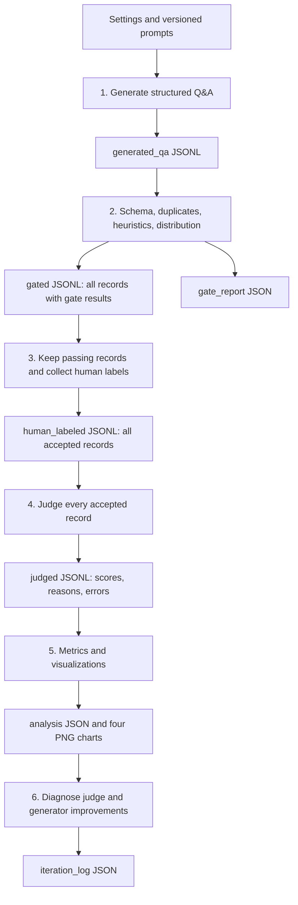
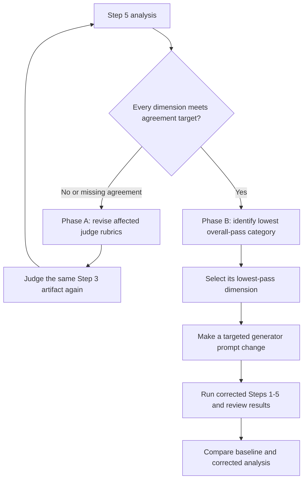

# Home DIY Repair Synthetic Q&A Pipeline

This project builds synthetic home-repair Q&A datasets and checks their quality in six stages: generation, automated checks, human review, LLM judging, analysis, and iteration. Each record keeps its trace ID and model metadata throughout the pipeline, so you can trace a failed answer back to the prompt that produced it.

The default setup runs locally with Ollama. You can switch the generator and judge to other providers through Instructor, and use either Ollama or OpenAI for embeddings.

## Contents

- [Pipeline overview](#pipeline-overview)
- [Setup](#setup)
- [Configuration](#configuration)
- [Run the pipeline](#run-the-pipeline)
- [Command reference](#command-reference)
- [Quality checks and evaluation](#quality-checks-and-evaluation)
- [Iteration and comparison](#iteration-and-comparison)
- [Data schema](#data-schema)
- [Artifacts and reports](#artifacts-and-reports)
- [Project structure](#project-structure)
- [Testing](#testing)
- [Troubleshooting](#troubleshooting)
- [Current limitations](#current-limitations)

## Pipeline Overview



| Stage | Purpose | External service or interaction |
| --- | --- | --- |
| 1. Generate | Generate one structured item per LLM call, with category and provenance | Generator model |
| 2. Gate | Validate structure, identify duplicate questions, apply lightweight checks, measure category balance | Embedding model unless disabled |
| 3. Human review | Label six quality dimensions on selected accepted items | Interactive terminal input |
| 4. Judge | Independently score all accepted items and explain each score | Judge model |
| 5. Analyze | Calculate pass rates, agreement, and segment metrics; save charts | No model calls |
| 6. Iterate | Recommend judge calibration or targeted generator correction | No model calls |

Generation covers five categories, with a target share of 20% each:

| Category | Example subject matter |
| --- | --- |
| `appliance_repair` | Refrigerators, washing machines, dryers, dishwashers, ovens |
| `plumbing_repair` | Leaks, clogs, fixtures, pipes |
| `electrical_repair` | Homeowner-level outlets, switches, and lighting |
| `hvac_maintenance` | Filters, thermostats, vents, basic troubleshooting |
| `general_home_repair` | Drywall, doors, windows, flooring, basic carpentry |

The pipeline measures dataset quality. A passing score does not establish that a repair is correct or safe; have someone with repair expertise review the content before using it as practical advice.

## Setup

### Prerequisites

- Python **3.14 or newer**, as required by `pyproject.toml`. `.python-version` selects 3.14.
- `uv` available in your terminal.
- For the default local setup, a running Ollama server and enough memory to load the configured models.
- An interactive terminal for human review.

Run commands from `diy-repair-project`. The examples below use PowerShell.

```powershell
cd .\diy-repair-project
uv sync
```

Skip `cd` if you're already in the project directory. `uv sync` installs the locked dependencies into `.venv`.

### Prepare the Default Local Models

```powershell
ollama pull qwen3.5:9b
ollama pull qwen3:14b
ollama pull nomic-embed-text
ollama list
```

If Ollama is not already running, start it in a separate terminal:

```powershell
ollama serve
```

Ollama defaults to `http://localhost:11434`. The generator and judge connect through Instructor using `/v1`; embedding calls use the Ollama client directly.

### Create Local Configuration

These are the defaults. To override them, create a `.env` file in the project root:

```dotenv
GENERATOR_MODEL=ollama/qwen3.5:9b
GENERATOR_TEMPERATURE=0.7
JUDGE_MODEL=ollama/qwen3:14b
JUDGE_TEMPERATURE=0.1
EMBEDDING_PROVIDER=ollama
EMBEDDING_MODEL=nomic-embed-text
OLLAMA_HOST=http://localhost:11434
OLLAMA_TIMEOUT=180
MAX_CONCURRENCY=2
SEMANTIC_DEDUP_THRESHOLD=0.90
HUMAN_JUDGE_AGREEMENT_TARGET=0.80
```

`config/settings.py` loads `.env` through `python-dotenv`. Variables already set in your terminal take precedence. Restart the command after changing a setting.

Before putting API keys in `.env`, add it to `.gitignore`. The current ignore file does not exclude it.

### Verify the CLI

```powershell
uv run .\main.py --help
uv run .\main.py generate --help
```

Both help commands run without calling a model.

## Configuration

### Environment Variables

| Variable | Effective default | Used for |
| --- | --- | --- |
| `GENERATOR_MODEL` | `ollama/qwen3.5:9b` | Step 1 model in `provider/model` format |
| `GENERATOR_TEMPERATURE` | `0.7` | Generation sampling temperature |
| `JUDGE_MODEL` | `ollama/qwen3:14b` | Step 4 model in `provider/model` format |
| `JUDGE_TEMPERATURE` | `0.1` | Judge sampling temperature |
| `MAX_CONCURRENCY` | `2` | Maximum concurrent Step 1 generation calls |
| `OLLAMA_HOST` | `http://localhost:11434` | Local LLM and embedding server address |
| `OLLAMA_TIMEOUT` | `180` | Timeout in seconds for generation, judging, and Ollama embeddings |
| `EMBEDDING_PROVIDER` | `ollama` | `ollama` or `openai` for Step 2 |
| `EMBEDDING_MODEL` | `nomic-embed-text` | Model identifier for the selected embedding provider |
| `SEMANTIC_DEDUP_THRESHOLD` | `0.90` | Minimum cosine similarity that marks a question as a duplicate |
| `HUMAN_JUDGE_AGREEMENT_TARGET` | `0.80` | Required agreement in every dimension for Phase A calibration |
| `BENCHMARK_DATASET` | `dipenbhuva/home-diy-repair-qa` | Configured reference dataset identifier; inspection module is currently absent |

Watch out for the duplicate `MAX_CONCURRENCY` assignment in `settings.py`: the later value wins, so the default is **2**. This setting controls generation; judging runs sequentially.

### Alternative Providers

Use a provider prefix in generator and judge model names, for example `openai/<model>` or `anthropic/<model>`. For providers other than Ollama, `utils/llm_client.py` calls `instructor.from_provider()`. Set the provider's credentials in the environment, typically `OPENAI_API_KEY` or `ANTHROPIC_API_KEY`.

Configure embeddings separately from the generator and judge. For OpenAI, set `EMBEDDING_PROVIDER=openai`, set `EMBEDDING_MODEL`, and provide `OPENAI_API_KEY`. Recheck the deduplication threshold when you change embedding models; similarity scores may shift.

### Constants in Source

Change these values directly in `config/settings.py`:

| Setting | Current value | Active behavior |
| --- | --- | --- |
| Structural validation target | `0.95` | `all` stops after Step 2 if fewer than 95% of input records validate |
| Category target and tolerance | `0.20 +/- 0.02` | Each expected category must represent 18%-22% of structurally valid records |
| Minimum safety information length | `80` characters | Step 2 safety heuristic |
| Minimum useful tip length | `20` characters | At least one tip must meet this length in Step 2 |

The settings file also defines a 50-item minimum dataset, at least 20 human labels, per-dimension targets, and an 80% overall pass target. Several are only declared targets: the pipeline does not enforce them. Human review warns below 20 labels, and comparison hardcodes an 80% failure-reduction requirement.

## Run the Pipeline

### Run Stages Individually

```powershell
# Step 1: 10 per category = 50 generated items
uv run .\main.py generate --count-per-category 10

# Step 2: validate, deduplicate, and record gate outcomes
uv run .\main.py gate

# Step 3: interactively label the first 20 accepted items
uv run .\main.py human-review --limit 20

# Step 4: judge every accepted item, including those without human labels
uv run .\main.py judge

# Step 5: calculate metrics and write charts
uv run .\main.py analyze

# Step 6: diagnose the next improvement to make
uv run .\main.py iterate
```

Without `--input`, a command picks the previous stage's newest artifact from `data/baseline/`. 'Newest' means the timestamp in the filename, regardless of when the file was last modified.

Check `gate_report_*.json` before starting human review. When you run stages individually, you must check the batch validation rate and category balance yourself. The `all` command enforces those checks.

### Run All Six Stages

```powershell
uv run .\main.py all --count-per-category 10 --human-label-count 20
```

`all` pauses for human labels in Step 3. It stops earlier if Step 2 fails the structural-validation or category-balance check. After generation, the Step 1 wrapper looks up the newest generated file; the remaining stages pass their output paths directly to the next stage.

### Select a Specific Input

```powershell
uv run .\main.py gate --input .\data\baseline\generated_qa_20261012002210.jsonl
uv run .\main.py iterate --input .\data\baseline\analysis_20261012_040251.json
```

Replace these filenames with files from your run. Relative paths start from your terminal's working directory. Steps 2-6 write their outputs beside the input file, even if it is outside `data/baseline/` or `data/corrected/`.

### Human Review

For each selected item, the terminal displays the question, problem, answer, tools, steps, safety information, and tips. Enter a pass or fail for each of the six dimensions:

- Pass: `1`, `pass`, `p`, `y`, or `yes`.
- Fail: `0`, `fail`, `f`, `n`, or `no`.

Use `--limit 0` to label every accepted item:

```powershell
uv run .\main.py human-review --limit 0
```

Step 3 keeps every accepted record, including those you haven't reviewed. Unreviewed records have `human_label: null`. Finish the review session before closing the terminal: labels are saved only after the loop completes.

## Command Reference

| Command | Options and defaults | Expected input |
| --- | --- | --- |
| `generate` | `--count-per-category 10`, `--corrected`, `--guidance TEXT` | No input artifact |
| `gate` | `--input PATH`, `--corrected`, `--no-semantic-dedup`, `--semantic-threshold 0.90` | `generated_qa_*.jsonl` |
| `human-review` | `--input PATH`, `--corrected`, `--limit 20`; `0` labels all | `gated_*.jsonl` |
| `judge` | `--input PATH`, `--corrected` | `human_labeled_*.jsonl` |
| `analyze` | `--input PATH`, `--corrected` | `judged_*.jsonl` |
| `iterate` | `--input PATH`, `--corrected` | `analysis_*.json` |
| `compare` | No options | Latest baseline and corrected analysis files |
| `all` | `--count-per-category 10`, `--human-label-count 20`, `--corrected`, `--guidance TEXT`, `--no-semantic-dedup`, `--semantic-threshold 0.90` | Generates a new dataset |
| `inspect-benchmark` | `--count 5`, `--split train` | Currently unavailable: imports missing `benchmark.inspect_samples` |

For consuming commands, `--corrected` selects `data/corrected/` for automatic input lookup. An explicit `--input` takes precedence. For `generate` and `all`, `--corrected` directs generated data to `data/corrected/`; it does not itself add correction guidance.

The semantic threshold's default comes from configuration and can be overridden on `gate` or `all`. Disabling semantic deduplication retains structural validation, exact duplicate detection, heuristics, and the distribution check.

## Quality Checks and Evaluation

### Step 2: Quality Gate

The gate applies the following checks:

1. **Structure:** Validate each record against `TraceRecord` and its nested `QAItem` schema. Schema failures become rejected records with reasons. Malformed JSON itself fails during file loading.
2. **Exact duplicates:** Normalize questions by lowercasing, removing punctuation, and collapsing whitespace. Later matches fail the gate.
3. **Semantic duplicates:** Embed questions and compare cosine similarity against earlier canonical records. Later questions with similarity at or above the threshold fail the gate. Answers are not embedded for this check.
4. **Heuristics:** Check basic completeness, safety-text length, tool wording, problem context, and tip length.
5. **Category balance:** Check all structurally valid records against the 18%-22% range for each configured category, rejecting unexpected categories at the batch level.

Category balance is checked before duplicate and heuristic failures are removed. Check the accepted records as well: their category mix can differ from the balance reported by the gate.

`gated_*.jsonl` keeps every record in its original order, with `gate_pass`, `gate_failures`, and `gate_result` added. Step 3 takes only passing records. Category balance is a batch check, so a failed balance check does not mark every record as failed.

### Six Quality Dimensions

Human reviewers and the LLM judge use the same binary dimensions. The LLM rubric lives in `config/judge_prompts.py`.

| Dimension | Review question | Step 2 heuristic |
| --- | --- | --- |
| D1 `answer_completeness` | Does the answer provide concrete end-to-end guidance without important gaps? | Nonblank answer and at least three steps |
| D2 `safety_specificity` | Are hazards and precautions specific to this repair? | At least 80 characters; reject generic-only safety text |
| D3 `tool_realism` | Are the tools accessible to a typical homeowner? | Require tools; reject configured professional/trade-only phrases in tools or answer |
| D4 `scope_appropriateness` | Is the task reasonably appropriate for homeowner DIY? | Nonblank equipment/problem; detailed judgment deferred to review |
| D5 `context_clarity` | Is the problem clear and directly addressed? | Nonblank question and equipment/problem |
| D6 `tip_usefulness` | Do tips add task-specific value beyond the main steps? | At least one tip with 20 or more characters |

Scores are binary: `0` or `1`. The schema sets `overall_pass` to true only when **all six** dimensions pass. Five out of six is still an overall failure.

The judge sees the Q&A content, with human labels and gate results withheld. It returns a score and explanation for each dimension. If a call fails, the record gets a `judge_error` and `judge_label: null`; the loop continues.

### Step 5: Reading the Metrics

- **Dimension pass rate:** Passing labels divided by available labels for that dimension, calculated separately for humans and the judge.
- **Overall pass rate:** Labels passing every dimension divided by available labels for that labeler.
- **Agreement:** Matching human/judge binary scores divided by records that have both labels, calculated separately for each dimension.
- **Segments:** Counts, pass rates, and agreement grouped by category and prompt variant.
- **Category distribution:** Shares among records in the judged file, compared with a fixed uniform 20% reference.

Read `human.count`, `judge.count`, and `agreement.paired_count` before interpreting the rates. Humans usually label a subset; judge rates cover all successfully judged records. Failed judge calls are excluded. Agreement is the fraction of matching scores, with no chance correction or confidence interval. Reports store missing metrics as `null`, but charts display them as zero, so check the JSON when a chart looks suspicious.

## Iteration and Comparison

Step 6 tells you what to work on next. You still need to edit the prompts and run the pipeline again.



### Phase A: Calibrate the Judge

If any dimension's agreement is missing or below `HUMAN_JUDGE_AGREEMENT_TARGET`, the status is `judge_recalibration_required` and `phase_b` is `null`.

Read the disagreements and judge explanations, then adjust the relevant rubric in `config/judge_prompts.py`. Increment `JUDGE_PROMPT_VERSION` so the output records identify the change. Judge the **same** human-labeled file again:

```powershell
uv run .\main.py judge --input .\data\baseline\human_labeled_<timestamp>.jsonl
uv run .\main.py analyze --input .\data\baseline\judged_<new_timestamp>.jsonl
uv run .\main.py iterate --input .\data\baseline\analysis_<new_timestamp>.json
```

Replace the placeholders with your filenames. Use explicit inputs here so calibration stays on the same dataset.

### Phase B: Improve the Generator

When every dimension meets the agreement target, Phase A returns `judge_calibrated`. Phase B selects the category with the lowest judge overall pass rate, then its lowest-pass dimension. It reports `generator_correction_required`, or `insufficient_data` if no usable judged segment exists.

Use the recommendation to make one focused change. Edit `config/generator_prompts.py` and increment `GENERATOR_PROMPT_VERSION`, or pass extra instructions through `--guidance`:

```powershell
uv run .\main.py all --corrected --count-per-category 10 --human-label-count 20 --guidance "For plumbing repairs, include task-specific shutoff and leak-check precautions."
uv run .\main.py compare
```

`--guidance` adds text to every generation prompt, including prompts for categories outside the one named in the guidance. Nonempty guidance adds `_corrected` to the recorded prompt variant. On its own, `--corrected` only selects the output directory.

Keep model settings, sample sizes, and human review consistent between runs. If you change the judge rubric, score the baseline again with that rubric before comparing generator results.

### Compare Results

`compare` selects the latest analysis in each run directory and writes `comparison_<timestamp>.json` under `data/corrected/`.

```text
baseline_failure_rate  = 1 - baseline_judge_overall_pass_rate
corrected_failure_rate = 1 - corrected_judge_overall_pass_rate
improvement_ratio     = (baseline_failure_rate - corrected_failure_rate)
                        / baseline_failure_rate
```

For example, reducing failure rate from 0.50 to 0.10 produces an improvement ratio of 0.80, meeting the report's 80% failure-reduction criterion. A negative ratio means failures increased. If the baseline failure rate is zero, the ratio is `null` and the criterion is false. Both reports need a non-null judge overall pass rate for comparison.

## Data Schema

### QAItem

| Field | Type | Schema requirement |
| --- | --- | --- |
| `question` | String | At least one character |
| `answer` | String | At least one character |
| `equipment_problem` | String | At least one character |
| `tools_required` | String list | At least one entry; entries cannot be blank |
| `steps` | String list | At least three entries; entries cannot be blank |
| `safety_info` | String | At least one character; stronger length check in Step 2 |
| `tips` | String list | At least one entry; entries cannot be blank |

### TraceRecord Lifecycle

| Stage | Fields added or populated |
| --- | --- |
| Generation | `trace_id`, `category`, `prompt_variant`, `generator_model`, `generator_timestamp`, `qa_item` |
| Gate | `gate_pass`, `gate_failures`, `gate_result` |
| Human review | `human_label`, or `null` for an unreviewed accepted record |
| Judge | `judge_label`, `judge_reasons`, `judge_error` |

Labels include the trace ID, labeler (`human` or `llm_judge`), UTC timestamp, six scores, and overall pass. Judge labels also contain judge model and prompt version. Schema validation ensures a label belongs to the same trace and the expected labeler.

Step 5 writes agreement to its aggregate report; it does not populate the optional per-trace `agreement` field. Legacy timestamp and prompt fields remain available in `TraceRecord` for compatibility.

This is a sample Step 1 record. Actual output also includes optional lifecycle fields set to `null` or empty collections. It is formatted here for readability; JSONL files store each record on one line.

```json
{
  "trace_id": "20261012002210123456",
  "category": "general_home_repair",
  "prompt_variant": "generator_v1",
  "generator_model": "ollama/qwen3.5:9b",
  "generator_timestamp": "2026-10-12T00:22:10.123456+00:00",
  "qa_item": {
    "question": "How can I stop an interior door hinge from squeaking?",
    "answer": "Support the door, clean the accessible hinge surfaces, apply a suitable lubricant, and check that the door moves freely.",
    "equipment_problem": "An interior door hinge squeaks when the door moves.",
    "tools_required": ["Clean cloth", "Suitable hinge lubricant"],
    "steps": [
      "Support the door and inspect the hinge for loose or damaged parts.",
      "Clean accessible hinge surfaces and apply lubricant as directed by its label.",
      "Move the door gently and wipe away excess lubricant."
    ],
    "safety_info": "Keep fingers away from hinge pinch points, support the door while working, and follow the lubricant label's ventilation precautions.",
    "tips": ["Protect the surrounding paint before applying lubricant to avoid staining."]
  }
}
```

## Artifacts and Reports

Artifacts use UTC timestamps. Step 1 currently writes `YYYYMMDDHHMMSS`; other stages use `YYYYMMDD_HHMMSS`. Automatic lookup accepts both formats.

| Artifact | Format | Contents |
| --- | --- | --- |
| `generated_qa_<timestamp>.jsonl` | One JSON object per line | Generated trace records |
| `gated_<timestamp>.jsonl` | JSONL | All input records with acceptance/rejection details |
| `gate_report_<timestamp>.json` | Single JSON document | Gate counts, validation rates, duplicate reports, distribution |
| `human_labeled_<timestamp>.jsonl` | JSONL | Accepted traces with optional human labels |
| `judged_<timestamp>.jsonl` | JSONL | Accepted traces with judge labels, explanations, errors |
| `analysis_<timestamp>.json` | Single JSON document | Pass rates, agreement, segments, chart paths |
| `iteration_log_<timestamp>.json` | Single JSON document | Phase A status and optional Phase B recommendation |
| `comparison_<timestamp>.json` | Single JSON document | Baseline/corrected failure rates and reduction criterion |

Step 5 writes four charts to `visualizations/` beside its input:

- `dimension_pass_rates_<timestamp>.png`: human and judge pass rates by dimension.
- `human_llm_agreement_<timestamp>.png`: agreement by dimension with its target line.
- `category_distribution_<timestamp>.png`: accepted dataset shares versus the fixed uniform reference.
- `segment_heatmap_<timestamp>.png`: judge pass rates by category and dimension.

The normal layout is:

```text
data/
  baseline/
    generated_qa_<timestamp>.jsonl
    gated_<timestamp>.jsonl
    gate_report_<timestamp>.json
    human_labeled_<timestamp>.jsonl
    judged_<timestamp>.jsonl
    analysis_<timestamp>.json
    iteration_log_<timestamp>.json
    visualizations/
      <chart_name>_<timestamp>.png
  corrected/
    <same stage artifacts>
    comparison_<timestamp>.json
    visualizations/
      <chart_name>_<timestamp>.png
```

Use `read_jsonl()` from `utils/jsonl_utils.py` for record files and `read_json()` for reports. Step 6 reads a complete JSON report; treating that file as JSONL will fail. Writers create missing output directories.

## Project Structure

```text
diy-repair-project/
  main.py                       # Unified command-line entry point
  pyproject.toml                # Python requirements and dependencies
  uv.lock                       # Dependency lockfile
  .python-version               # Python 3.14 selection
  README.md
  config/
    settings.py                 # Environment loading, models, thresholds, paths
    generator_prompts.py        # Generator prompt, version, correction addendum
    judge_prompts.py            # Judge rubric, version, item prompt
  models/
    qa_item.py                  # Structured repair Q&A schema
    labels.py                   # Binary scores, judge decisions, label records
    trace.py                    # Provenance and lifecycle schema
  pipeline/
    step1_generate.py           # Concurrent structured generation
    step2_quality_gate.py       # Validation, duplicates, heuristics, reporting
    step3_human_label.py        # Interactive human review
    step4_llm_judge.py          # Independent model evaluation
    step5_analysis.py           # Aggregate metrics and PNG charts
    step6_iteration.py          # Calibration and correction diagnosis
    compare.py                  # Baseline/corrected comparison
  utils/
    artifact_utils.py          # Timestamp parsing and input selection
    concurrency.py             # Thread-pool generation and progress
    embedding_client.py        # Ollama/OpenAI embedding adapters
    jsonl_utils.py              # JSON/JSONL readers and writers
    llm_client.py               # Instructor provider client factory
    logging_util.py            # Event logging helper
  tests/
    conftest.py                 # Shared Q&A, trace, and label fixtures
    test_step1_generate.py      # Mocked generation and output routing
    test_step2_quality_gate.py  # Validation, duplicates, heuristics, reports
    test_step3_human_label.py   # Human input, filtering, label limits
    test_step4_llm_judge.py     # Judge scores, provenance, error recovery
    test_step5_analysis.py      # Metrics, agreement, real PNG chart output
    test_step6_iteration.py     # JSON loading, calibration, correction selection
    test_compare.py            # Relative failure reduction and edge cases
    test_pipeline_workflow.py   # Mocked six-stage workflow and batch stops
    test_embedding_client.py    # Live embedding shape check
  data/                         # Run artifacts
  main.pyold                    # Older entry-point copy
  test_code.py                  # Scratch script with a stale util import
```

Start with `main.py`. Settings define separate benchmark, report, log, and visualization paths, but the active pipeline writes reports and charts beside its inputs. The event logging helper is not connected to the pipeline.

## Testing

Install development dependencies and run the offline pipeline tests:

```powershell
uv sync --group dev
uv run pytest tests/ --ignore=tests/test_embedding_client.py -v
```

The offline tests mock model calls, embeddings, and human input. They cover all six stages, comparison, the full workflow, and stopping before human review when batch checks fail. Outputs go to temporary directories, and chart tests use Matplotlib's `Agg` backend. Step 6 also has a regression test for loading the analysis report as JSON rather than JSONL.

The embedding test calls the configured provider. With the defaults, start Ollama and pull `nomic-embed-text` first. The test checks vector count and shape; it does not measure embedding quality. Run it separately, or run all tests once the provider is ready:

```powershell
uv run pytest tests/test_embedding_client.py -v
uv run pytest tests/ -v
```

Use `pytest tests/` rather than unrestricted discovery: root-level `test_code.py` is a scratch script importing nonexistent `util.llm_client` and can cause collection errors.

For an integration check, run a small batch through each stage. Inspect the gate report, judge errors, paired label count, analysis, and iteration log. A small run checks that the pieces work together; use at least 50 generated items and 20 human labels when assessing the project's stated dataset goals.

## Troubleshooting

| Symptom | Likely cause | Action |
| --- | --- | --- |
| Cannot connect to Ollama | Server is stopped or host is incorrect | Start Ollama and check `OLLAMA_HOST` |
| Model not found | A configured model is not installed | Check `ollama list` and pull the configured model |
| Model identifier error | Missing `provider/` prefix | Use a value such as `ollama/qwen3.5:9b` for generator/judge configuration |
| Timeout, memory pressure, or rate limits | Model calls exceed available resources | Lower `MAX_CONCURRENCY`, adjust `OLLAMA_TIMEOUT`, or select models suitable for your machine |
| Embedding provider error | Unsupported provider, unavailable model, or missing credentials | Verify `EMBEDDING_PROVIDER`, `EMBEDDING_MODEL`, and provider access; temporarily use `--no-semantic-dedup` to isolate the issue |
| No matching timestamped file | Prior stage has not run, wrong run directory, or filename does not match | Run the preceding stage, select `--corrected` if needed, or provide `--input` |
| `all` stops after Step 2 | Structural rate below 95% or category balance outside 18%-22% | Inspect `gate_report_*.json` and correct generation or schema problems |
| No Step-2-passing records | All items were rejected | Inspect `gate_failures` and duplicate/heuristic details before regenerating |
| Human/judge metrics are `null` | No usable labels or no paired labels | Check label counts, `human_label`, and `judge_error`; rerun the affected stage |
| `judge_recalibration_required` | At least one agreement score is missing or below target | Revise the affected judge rubric and rerun judging on the same human-labeled artifact |
| `JSONDecodeError` | Malformed input or JSON/JSONL format mismatch | Steps 2-5 consume JSONL; Step 6 consumes the single-document analysis JSON |
| `inspect-benchmark` fails to import | `benchmark.inspect_samples` is absent | Treat benchmark inspection as an incomplete extension |
| Pytest collection fails on `util` | Scratch `test_code.py` was collected | Run `uv run pytest tests/ -v` |

When resuming a run, pass `--input` explicitly. Otherwise, a newer file from another run can be selected.

## Current Limitations

- **Review sampling is biased by file order.** Human review takes the first accepted records, and generation groups records by category. The default sample can therefore favor early categories. Random or stratified sampling, review resume, and reviewer reconciliation are not implemented.
- **The benchmark is configured but not integrated.** The active pipeline does not load it. Distribution reports compare against a fixed 20% per category.
- **Some targets are not enforced.** This includes the minimum dataset size and most dimension and overall pass targets. After checking agreement, Step 6 recommends a generator correction whenever it finds a usable segment, even if that segment already has a perfect pass rate.
- **Iteration still needs manual work.** Step 6 does not edit prompts or start corrected runs. `compare` measures failure reduction across the whole judged dataset; it does not isolate the targeted category or dimension, or test statistical significance.
- **Runs are traceable, but not fully reproducible.** Records include prompt and model identifiers. They do not capture a generation seed, pinned model weights, or a complete configuration manifest. Concurrent runs can also confuse Step 1's newest-file lookup, and filenames can collide when written in the same second.
- **Large batches and interrupted runs need more work.** Semantic deduplication uses pairwise comparisons, so comparison cost grows quadratically. Files are loaded into memory. Generation has no checkpoints, and an error can prevent the batch from being saved. Judging records per-item errors, but retrying those failures is manual.
- **Tests cover mechanics, not model quality.** Offline tests use mocked responses, and the live embedding test checks shape. Real provider behavior, judge calibration on representative samples, and repair accuracy still need to be checked with actual runs and domain review.
